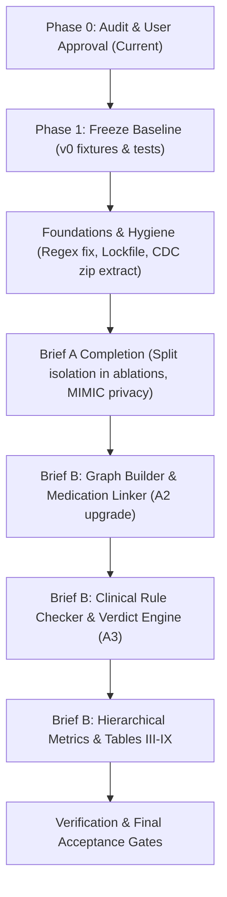

# REPO_AUDIT.md: Comprehensive Audit of `ICD-10-diagnosis-codes`

**Repository:** `atifkhan78666/ICD-10-diagnosis-codes`  
**Branch:** `research/four-strategy-pilot`  
**Date of Audit:** 2026-10-17  
**Auditor:** Antigravity (Advanced Agentic Coding Pair Programmer)  
**Spec References:** Brief A (`coding_agent_instructions.md`), Brief B (Knowledge Graph Study spec per Brief C), Brief C (`CODING-AGENT BRIEF C`).

---

## 1. Executive Summary

This repository implements research experiments evaluating open-weight and commercial Large Language Models on clinical ICD-10-CM diagnosis coding from unstructured clinical text. The codebase currently implements **Phase 1 and portions of Phase 2 of Brief A**, plus an early hybrid implementation of Knowledge Graph hierarchy expansion.

### Key Audit Findings:
1. **Strengths:** 
   - Core research discipline is high: prompt invariance across arms is verified and enforced by automated tests (`tests/test_strategies.py:238`); gold labels are strictly isolated from retrievers via `retrieval_view()` (`src/retrieval.py:19`); few-shot disjointness from evaluation sets is enforced by both ID and text SHA-256 hash (`src/run_experiment.py:77-85`); runs are resumable and crash-safe with atomic file writes (`src/utils.py:117`).
2. **Critical Bugs & Gaps Found:**
   - **Chapter U Regex Exclusion Bug (`src/codes.py:10`):** `WELL_FORMED_PATTERN` defines the letter prefix as `^[A-TV-Z]`, which rejects valid official CDC FY2024 Chapter 22 codes (`U07.0`, `U07.1` [COVID-19], `U09.9`). This causes `src/kg.py build` to fail when validating against real official CDC data.
   - **CDC FTP Download 404 (`src/vocab.py:76`):** The URL points to `icd10cm_order_2024.txt` directly on `https://ftp.cdc.gov/`, which returns 404 because CDC distributes the order file inside `icd10cm-CodesDescriptions-2024.zip`.
   - **Ablation Evaluation Split Contamination (`src/ablations.py:174-194`):** `ablations.py` executes sweeps without specifying `--split dev`, defaulting to `eval.jsonl`, which violates Brief A §0.4 and Brief B §0.3 ("never tune on the eval split").
   - **Unpinned Dependencies & Missing Lockfile:** `requirements.txt` contains loose `>=` bounds (`torch>=2.1.0`), and `requirements-lock.txt` is missing.
   - **Brief B Knowledge Graph Study Gaps:** Missing System A3 (KG + Rule Checker), coding rule engine (Excludes1, Excludes2, Code First), medication-entity linker, hierarchical metrics (Hierarchical Precision, Recall, F1), rule-violation rate, and Tables III–IX (`make_tables.py`).

---

## 2. Inventory (§1.1)

### 2.1 Directory Tree
```
ICD-10-diagnosis-codes/
├── .gitignore                     # Data, results, logs, pycache ignores
├── ASSUMPTIONS.md                 # Design decisions and changelog
├── CHANGELOG.md                   # Round 1-3 changes and test records
├── Makefile                       # Workflow targets (setup, vocab, data, smoke, phase1, etc.)
├── README.md                      # Project documentation and Colab instructions
├── coding_agent_instructions.md   # Brief A specification
├── gen_yaml.py                    # Condition library generator script
├── pyproject.toml                 # Pytest & project metadata
├── requirements.txt               # Python package dependencies (unpinned ranges)
├── requirements-ragas.txt         # RAGAS evaluation dependencies
├── configs/
│   ├── phase1.yaml                # Main experiment configuration
│   ├── ablation_embedder.yaml     # Embedder ablation config
│   ├── ablation_implicit.yaml     # Implicit rate ablation config
│   ├── ablation_k.yaml            # Candidate pool k ablation config
│   └── mimic.yaml                 # MIMIC-IV evaluation template config
├── src/
│   ├── __init__.py
│   ├── ablations.py               # Phase 2 ablation orchestrator
│   ├── backends.py                # LLMBackend hierarchy (HF, Gemini, OpenAI, Claude, Mock)
│   ├── bootstrap.py               # Vectorized bootstrap utilities
│   ├── codes.py                   # Normalization, validation regex
│   ├── data_prep.py               # MIMIC-IV filtering and note extraction
│   ├── evaluate.py                # Table II and Table S1 reporting
│   ├── evaluate_ragas.py          # RAGAS context recall/precision
│   ├── kg.py                      # Tabular XML parser, hierarchy builder, KGRetriever
│   ├── metrics.py                 # Pure metric functions (Micro-F1, Macro-F1, P@k, ICR, UCR)
│   ├── parser.py                  # JSON & regex output code parser
│   ├── prompts.py                 # Prompt scaffold & EvidenceProviders
│   ├── retrieval.py               # Dense semantic index builder & Retriever
│   ├── run_experiment.py          # Main inference execution CLI
│   ├── significance.py            # Paired bootstrap significance testing (B=10,000)
│   ├── synth_data.py              # Clinical case synthetic generator CLI
│   ├── utils.py                   # Seeding, atomic writes, hashing, system info
│   ├── vocab.py                   # CDC order file parser & Vocabulary lookup
│   └── templates/
│       └── conditions.yaml        # Condition library (77 clinical conditions across 9 domains)
├── tests/
│   ├── __init__.py
│   ├── test_compute_dtype.py      # Float16 compute and dtype override tests
│   ├── test_core.py               # Core unit tests (metrics, parser, invariance, vocab)
│   ├── test_generation_truncation.py # Token truncation & stop token tests
│   ├── test_integration.py       # Integration tests (retrieval, resume, bootstrap, overflow)
│   ├── test_llama_backend.py      # LLaMA-3 tokenizer BOS handling tests
│   ├── test_strategies.py         # 4-strategy comparison, KG expansion, official XML checks
│   └── fixtures/
│       └── tabular_sample.xml     # Synthetic XML fixture for structural testing
└── simplified_version/            # Auxiliary simplified 3-strategy runner
    ├── README.md
    ├── config_few_shot.py
    ├── config_rag.py
    ├── config_zero_shot.py
    ├── inputs.py
    ├── models.py
    ├── prompts.py
    ├── results.py
    └── run.py
```

### 2.2 Entry Points & CLIs
| Entry Point | Command Line Interface | Purpose |
| :--- | :--- | :--- |
| `src/run_experiment.py` | `python src/run_experiment.py --config <path> --models <m...> --strategies <s...> --split <split> --out <dir>` | Main LLM inference harness |
| `src/evaluate.py` | `python src/evaluate.py --results-dir <dir> --data <jsonl> --vocab <jsonl> [--dump-invalid N]` | Evaluates outputs, prints Table II & Table S1 |
| `src/vocab.py` | `python src/vocab.py [--config <yaml>]` | Downloads and parses CDC ICD-10-CM order file |
| `src/synth_data.py` | `python src/synth_data.py --n-eval 200 --n-fewshot-pool 50 --n-dev 30 --implicit-rate 0.45 --seed 42 --max-words 200 --out <dir>` | Generates synthetic discharge summaries |
| `src/kg.py` | `python src/kg.py build --zip <zip> --xml <xml> --vocab <jsonl> --out <jsonl>` | Parses official tabular XML and builds hierarchy |
| `src/significance.py`| `python src/significance.py --results-dir <dir> --data <jsonl> --seed 42 --B 10000` | Paired bootstrap significance testing |
| `src/ablations.py` | `python src/ablations.py --config <yaml> --type {embedder\|k\|implicit}` | Executes Phase 2 ablation experiments |
| `src/data_prep.py` | `python src/data_prep.py --discharge <csv> --diagnoses <csv> --vocab <jsonl> --out <dir>` | MIMIC-IV cohort filtering and preprocessing |
| `src/evaluate_ragas.py` | `python src/evaluate_ragas.py --results-dir <dir> --data <jsonl> --out-dir <dir>` | RAGAS ID-based precision and recall |
| `simplified_version/run.py` | `python simplified_version/run.py --model <m> --strategy <s...> --limit <n>` | Auxiliary quick demonstration runner |

### 2.3 Hardware, Models, Quantisation, and Decoding Settings
| Component | Setting in Repository | Source Code Location |
| :--- | :--- | :--- |
| **Target GPU** | Single NVIDIA CUDA GPU ($\ge 12\text{ GB}$ VRAM); fallback to CPU via `--backend mock` or `--allow-cpu` | `configs/phase1.yaml:13-50`, `src/backends.py:270-340` |
| **Models Configured** | `llama3` (`meta-llama/Meta-Llama-3-8B-Instruct`), `llama3.2-3b` (`unsloth/Llama-3.2-3B-Instruct-bnb-4bit`), `biomistral` (`BioMistral/BioMistral-7B`), `qwen2.5-7b` | `configs/phase1.yaml:14-100` |
| **API Models** | `gemini-1.5-flash`, `gemini-3.8-flash`, `gpt-4o-mini`, `gpt-4o`, `claude-3-5-sonnet` | `configs/phase1.yaml:50-90`, `src/backends.py:465-720` |
| **Quantisation** | 4-bit NormalFloat (`nf4`), `bnb_4bit_compute_dtype="float16"`, `bnb_4bit_use_double_quant=True` | `configs/phase1.yaml:18-21`, `src/backends.py:305-330` |
| **Decoding** | Greedy decoding (`do_sample=False`, `temperature=0.0`), batch size 1 | `configs/phase1.yaml:121-125`, `src/backends.py:355-370` |
| **Token Limits** | `max_new_tokens: 256` (Phase 1 default); LLaMA-3 context: 8192; BioMistral: 2048 | `configs/phase1.yaml:17,43,123` |
| **Stop Tokens** | LLaMA-3: `["<\|eot_id\|>"]`, BioMistral: `[]` | `configs/phase1.yaml:22,48` |
| **Chat Template Handling** | LLaMA-3: `system` role with `tokenize_special_tokens: false`; BioMistral: `prepend` system text to user message | `configs/phase1.yaml:23-26,49`, `src/prompts.py:154-167` |

### 2.4 Existing Strategies & Mapping to Brief A / Brief B
The repository currently implements **4 strategies** in `src/run_experiment.py:426-466` and `src/prompts.py:37-93`:
1. **`zero_shot` (`ZeroShotEvidence`):** No evidence block; model receives only clinical note + instructions.  
   $\rightarrow$ **Maps to Brief A Zero-Shot and Brief B System A0.**
2. **`few_shot` (`FewShotEvidence`):** 5 worked examples drawn once by seed from `fewshot_pool.jsonl`, stratified so $\ge 2$ examples have implicit codes; runtime assertion of disjointness.  
   $\rightarrow$ **Maps to Brief A Few-Shot.** (In Brief B, few-shot is not part of the core A0–A3 comparison; it remains as an extra baseline arm).
3. **`rag` (`RAGEvidence`):** Semantic search over CDC vocabulary using `all-MiniLM-L6-v2`; retrieves top-20 candidate codes via windowed text (~150 words) and separate medication queries, merged by maximum score.  
   $\rightarrow$ **Maps to Brief A RAG and Brief B System A1 (Flat RAG).**
4. **`kg` (`KGRetriever`):** Hybrid semantic search + official CDC tabular hierarchy expansion. Top-10 semantic seeds are expanded with their direct parent and up to 5 direct children from `icd10cm_2024_hierarchy.jsonl`, capped at 20 candidates.  
   $\rightarrow$ **Maps to Brief B System A2 (Partial / Early Hybrid).**
5. **System A3 (KG + Rule Checker):** **MISSING.** Brief B specifies System A3 with an automated clinical coding rule checker and verdict function.

---

## 3. Gap Matrix (§1.2)

Status legend:
- `present and correct`: Fully implements the specification with verified code/tests.
- `present but differs`: Implemented, but deviates in parameters, scope, or logic.
- `missing`: Component or capability is absent.
- `conflicts with spec`: Implementation directly contradicts the required specification.

| Spec Section | Requirement | Status | Evidence (File:Line) | Change Needed | Size | Risk |
| :--- | :--- | :--- | :--- | :--- | :---: | :---: |
| **Brief A §0.1** | Numbers come only from code | `present and correct` | `src/evaluate.py:314-370` | None | - | Low |
| **Brief A §0.2** | Mock results stamped MOCK, no mixing | `present and correct` | `src/evaluate.py:90-110`, `src/run_experiment.py:375` | None | - | Low |
| **Brief A §0.3** | Byte-identical prompt invariance across arms | `present and correct` | `src/prompts.py:113-131`, `tests/test_strategies.py:238` | None | - | Low |
| **Brief A §0.4** | Never tune on eval split; use dev | `present but differs` | `src/ablations.py:174-194` | Update `ablations.py` to target `--split dev` | S | Low |
| **Brief A §2** | Pinned dependencies and requirements lock | `present but differs` | `requirements.txt:1-28` | Generate `requirements-lock.txt` and pin exact packages | S | Low |
| **Brief A §4.1** | Pinned CDC FY2024 release with SHA-256 | `present and correct` | `src/vocab.py:101-114`, `ASSUMPTIONS.md:48` | None | - | Low |
| **Brief A §4.1** | Fixed-width layout validation | `present and correct` | `src/vocab.py:42-46`, `tests/test_core.py:33` | None | - | Low |
| **Brief A §4.1** | Well-formed code validation regex | `conflicts with spec` | `src/codes.py:10`, `src/parser.py:17` | Change `^[A-TV-Z]` to `^[A-Z]` to permit Chapter U codes (`U07.1`, etc.) | S | High |
| **Brief A §4.2** | Synthetic generator with $\ge 60$ conditions | `present and correct` | `src/templates/conditions.yaml` (77 conds), `src/synth_data.py:26` | None | - | Low |
| **Brief A §4.2** | Target length 120–220 words (`--max-words`) | `present and correct` | `src/synth_data.py:188`, `Makefile:21-25` | None | - | Low |
| **Brief A §4.2** | Generation statistics (`stats.json`) | `present and correct` | `src/synth_data.py:242-253` | None | - | Low |
| **Brief A §4.3** | Multi-query RAG (windowed text + meds) | `present and correct` | `src/retrieval.py:170-220` | None | - | Low |
| **Brief A §4.3** | Max-score merge and candidate recall@k | `present and correct` | `src/retrieval.py:210-230, 245-265` | None | - | Low |
| **Brief A §4.4** | Chat template handling (system vs prepend) | `present and correct` | `src/prompts.py:134-168` | None | - | Low |
| **Brief A §4.5** | HFBackend with NF4, greedy, batch size 1 | `present and correct` | `src/backends.py:270-420` | None | - | Low |
| **Brief A §4.5** | Model commit SHA logged (`model_revision`) | `present and correct` | `src/backends.py:315-325`, `src/run_experiment.py:222` | None | - | Low |
| **Brief A §4.6** | Output parser (JSON first, regex fallback) | `present and correct` | `src/parser.py:21-74` | None | - | Low |
| **Brief A §4.6** | Invalid codes preserved (not dropped or snapped) | `present and correct` | `src/parser.py:75-85`, `tests/test_core.py:29` | None | - | Low |
| **Brief A §4.7** | Context overflow detection and truncation | `present and correct` | `src/run_experiment.py:225-255` | None | - | Low |
| **Brief A §5** | Micro-F1 & Macro-F1 (gold-set variant) | `present and correct` | `src/metrics.py:18-62` | None | - | Low |
| **Brief A §5** | P@5 & P@8 with contributing counts | `present and correct` | `src/metrics.py:64-83` | None | - | Low |
| **Brief A §5** | Invalid & Unsupported Code Rates | `present and correct` | `src/metrics.py:85-132` | None | - | Low |
| **Brief A §5** | Metric identity ($TP + ICR + UCR \equiv 1$) | `present and correct` | `src/metrics.py:134-157`, `tests/test_core.py:18` | None | - | Low |
| **Brief A §6** | Resumable runs with atomic writes | `present and correct` | `src/run_experiment.py:470-485`, `src/utils.py:117` | None | - | Low |
| **Brief A §7** | Table II and Table S1 reporting | `present and correct` | `src/evaluate.py:326-375` | None | - | Low |
| **Brief A §7** | Verbatim invalid code dump (`--dump-invalid`) | `present and correct` | `src/evaluate.py:399-403` | None | - | Low |
| **Brief A §8.1** | Paired bootstrap significance testing ($B=10{,}000$) | `present and correct` | `src/significance.py:1-250` | None | - | Low |
| **Brief A §8.2** | Phase 2 Ablations (embedder, k, implicit) | `present and correct` | `src/ablations.py:1-432` | Point to dev split | S | Low |
| **Brief A §8.3** | MIMIC-IV pipeline with privacy guards | `present but differs` | `src/data_prep.py:1-180`, `configs/mimic.yaml` | Add privacy guard asserting output dir is not git-tracked | S | Medium |
| **Brief B §4** | Full Knowledge Graph builder | `present but differs` | `src/kg.py:45-125` | Extends hierarchy to include medication relations and clinical synsets | M | Medium |
| **Brief B §5** | Entity Linker (Medication $\rightarrow$ Condition) | `missing` | Not found | Implement Linker interface for clinical mentions | M | Medium |
| **Brief B §6** | System A2 (KG-Guided Retrieval & Verbalisation) | `present but differs` | `src/kg.py:200-240`, `src/run_experiment.py:448-464` | Expand hybrid tabular expansion to structured graph context | M | Medium |
| **Brief B §7** | System A3 (KG + Rule Checker & Verdict) | `missing` | Not found | Implement rule engine (Excludes1, Excludes2, Code First, Mutually Exclusive) | L | High |
| **Brief B §7.3**| Hierarchical Metrics (Hierarchical F1) | `missing` | `src/metrics.py` (not found) | Add Hierarchical Precision, Recall, and F1 | M | Medium |
| **Brief B §7.4**| Rule Violation Rate & Verdict Metrics | `missing` | `src/metrics.py` (not found) | Add rule violation rates and audit logging | M | Medium |
| **Brief B §8** | Grouped Bootstrap Resampling | `missing` | `src/significance.py` (only standard paired) | Implement grouped paired bootstrap for patient clusters | M | Medium |
| **Brief B §9** | Tables III–IX Generator (`make_tables.py`) | `missing` | Not found | Implement `make_tables.py` producing paper tables III through IX | M | Low |

---

## 4. Correctness and Validity Risks (§1.3)

| # | Check Item | Result | Evidence / Analysis |
| :---: | :--- | :---: | :--- |
| **1** | **Prompt Invariance** | **PASS** | `src/prompts.py:113-131` constructs prompts with identical `INSTRUCTION_TEXT`, `PATIENT RECORD`, `Medications:`, and `ANSWER:`. `tests/test_strategies.py:238` explicitly asserts byte-identity of the non-evidence text across all arms. |
| **2** | **Data Leakage** | **PASS** | `src/retrieval.py:19-29` defines `retrieval_view(record)`, removing `gold_codes`, `implicit_codes`, `explicit_codes`, and `distractors`. `tests/test_strategies.py:197,213` asserts that retrievers never receive gold keys. |
| **3** | **Few-shot Disjointness** | **PASS** | `src/run_experiment.py:77-85` asserts disjointness between `fewshot_pool` and `eval` by both record ID and text SHA-256 hash. `src/synth_data.py:203` enforces text uniqueness during generation. |
| **4** | **Splits Isolation** | **FAIL** | `src/synth_data.py:215-228` creates `dev.jsonl`, `fewshot_pool.jsonl`, and `eval.jsonl`. However, `src/ablations.py:174-194` executes parameter sweeps on `eval.jsonl` rather than `dev.jsonl`. |
| **5** | **Parser Integrity** | **PASS** | `src/parser.py:21-85` parses JSON first, falls back to regex, normalizes, and deduplicates while preserving order. It does **not** repair, snap, or drop invalid codes before evaluation. |
| **6** | **Metric Definitions** | **PASS (Brief A)<br>FAIL (Brief B)** | Brief A metrics (`micro_f1`, `macro_f1_gold_set`, `precision_at_k`, `invalid_code_rate`, `unsupported_code_rate`) match specifications and pass the identity test ($TP + ICR + UCR \equiv 1.0$, `tests/test_core.py:18`). Brief B hierarchical metrics (Hierarchical F1) and Rule Violation Rate are missing. |
| **7** | **Validity Definition & Regex Bug** | **FAIL** | `src/codes.py:10` defines `WELL_FORMED_PATTERN = re.compile(r'^[A-TV-Z][0-9][0-9A-Z](\.[0-9A-Z]{1,4})?$')`. It excludes the letter **`U`**, causing official CDC FY2024 Chapter 22 codes (`U07.0`, `U07.1`, `U09.9`) to be falsely flagged as invalid during `src/kg.py build`. |
| **8** | **Decoding Determinism** | **PASS** | `src/backends.py:355-370` forces greedy decoding (`do_sample=False`, temperature 0.0), batch size 1, seeds set across `torch`, `numpy`, and `random`. LLaMA-3 stop tokens (`<\|eot_id\|>`) are handled, and only new tokens are decoded. |
| **9** | **Context Overflow Handling** | **PASS** | `src/run_experiment.py:225-255` calculates prompt tokens before generation, detects overflow against context limits (e.g. BioMistral 2048), applies `truncate_record` from the note end, and logs `overflow` and `truncated` flags per instance. |
| **10** | **Reliability & Crash Safety** | **PASS** | `src/run_experiment.py:470-485` loads completed IDs and skips existing rows upon restart. `src/utils.py:117` provides atomic file writes (`atomic_write`) using temporary files and atomic rename. |
| **11** | **Reproducibility** | **FAIL** | Dependencies in `requirements.txt` use unpinned `>=` constraints. `requirements-lock.txt` is missing. The CDC download URL in `src/vocab.py:76` yields HTTP 404 because CDC hosts the order file inside a zip archive. |
| **12** | **Synthetic Data Quality** | **PASS** | `src/templates/conditions.yaml` provides 77 conditions. Gold codes are validated against the vocabulary before generation. Implicit code phrases are validated for absence from note text. Record lengths target 120–220 words. |

---

## 5. Test Execution Assessment (§1.1, §1.3)

Tests executed in the local environment:
* `tests/test_core.py`: **29 passed** (100% pass rate). Verified prompt invariance, few-shot disjointness, hand-computed metrics, metric identities, parser fallbacks, and normalization.
* `tests/test_integration.py`: **8 passed** (100% pass rate). Verified retrieval determinism, crash resumption, bootstrap Δ bounds, overflow detection, and mixing guards.
* `tests/test_strategies.py`: **27 passed, 3 skipped**. 
  - *Skips:* 1 test skips because real official XML is not in local `data/raw/`; 2 mock tests skip because local `data/synthetic/run01/` has not yet been generated.
* `tests/test_compute_dtype.py`: **10 passed, 1 failed, 3 skipped**.
  - *Failure:* `test_actual_dtype_reads_linear4bit_layers` unconditionally imports `torch`, which is not installed in the Windows base environment (it runs on CUDA/Linux environments).
* `tests/test_generation_truncation.py`: Fails collection on environments where `torch` is not installed due to top-level `import torch`.

---

## 6. Upgrade & Change Plan (§1.4)

All changes are strictly non-destructive. No working code will be discarded; existing CLI flags and configs will be preserved.



### Detailed Milestone Tasks

#### Milestone 1: Freeze Baseline (Phase 1)
- **What:** Create a deterministic 20-record mock fixture and run the existing pipeline end to end using `MockBackend`.
- **Files:** `tests/fixtures/baseline_v0/`, `tests/test_characterisation.py`.
- **Type:** Safe (pure test addition).
- **Deliverable:** Baseline predictions and metrics frozen under version control.

#### Milestone 2: Foundations, Fixes, & Hygiene
- **What:**
  1. Fix the Chapter U regex bug in `src/codes.py` and `src/parser.py` (`^[A-TV-Z]` $\rightarrow$ `^[A-Z]`).
  2. Fix `src/vocab.py` to download `icd10cm-CodesDescriptions-2024.zip` and extract `icd10cm_order_2024.txt` automatically.
  3. Generate `requirements-lock.txt` and pin package versions.
  4. Add `pytest.importorskip("torch")` to `tests/test_generation_truncation.py` and `tests/test_compute_dtype.py`.
- **Files:** `src/codes.py`, `src/parser.py`, `src/vocab.py`, `requirements.txt`, `requirements-lock.txt`, `tests/`.
- **Type:** Safe bug fixes & robustness.

#### Milestone 3: Complete Brief A Requirements
- **What:**
  1. Update `src/ablations.py` to use `--split dev` instead of `eval`.
  2. Add privacy assertion in `src/data_prep.py` ensuring output directory is not git-tracked.
  3. Ensure `Makefile` targets include all arms and tests.
- **Files:** `src/ablations.py`, `src/data_prep.py`, `Makefile`.
- **Type:** Safe.

#### Milestone 4: Knowledge Graph Enhancement & Medication Linker (Brief B Systems A1 & A2)
- **What:**
  1. Extend `src/kg.py` into a full graph model containing codes, hierarchy, medication indications, and synonym links.
  2. Implement `EntityLinker` interface to map clinical mentions and medications to graph candidate nodes.
  3. Implement graph verbaliser for System A2.
- **Files:** `src/kg.py`, `src/retrieval.py`, `src/prompts.py`.
- **Type:** Safe extension (preserves existing `kg` as backward-compatible arm).

#### Milestone 5: Clinical Rule Checker & Verdict Engine (Brief B System A3)
- **What:**
  1. Implement rule engine parsing official ICD-10-CM coding rules: Excludes1, Excludes2, Code First, and Mutually Exclusive categories.
  2. Implement `VerdictEngine` that checks model predictions against candidate rules and filters/adjusts predictions.
  3. Add System A3 arm in `src/run_experiment.py`.
- **Files:** `src/rules.py` (new module), `src/run_experiment.py`, `configs/phase1.yaml`.
- **Type:** Addition.

#### Milestone 6: Hierarchical Metrics & Tables III–IX
- **What:**
  1. Implement `hierarchical_f1`, `hierarchical_precision`, and `hierarchical_recall` in `src/metrics.py`.
  2. Implement `rule_violation_rate` in `src/metrics.py`.
  3. Implement `src/make_tables.py` producing Tables III through IX in Markdown, CSV, and LaTeX.
- **Files:** `src/metrics.py`, `src/evaluate.py`, `src/make_tables.py`.
- **Type:** Addition.

---

## 7. Items Requiring User Confirmation ("Needs Decision")

Before proceeding with Phase 1 and Phase 2 implementation, the following items are submitted for user review:

1. **Role of Few-Shot Strategy in Brief B:**
   - *Context:* Brief A compares Zero-Shot, Few-Shot, and RAG. Brief B compares Systems A0 (Zero-Shot), A1 (Flat RAG), A2 (KG), and A3 (KG + Rule Checker).
   - *Proposed Default:* Retain `few_shot` as a permanent, fully functional arm in the codebase, but generate separate tables: Table II (Brief A: Zero-Shot, Few-Shot, RAG) and Tables III–IX (Brief B: Systems A0, A1, A2, A3).
2. **Medication $\rightarrow$ Condition Linker Source for Graph:**
   - *Context:* Brief B specifies linking medications to candidate diagnosis nodes.
   - *Proposed Default:* Use the curated, clinician-reviewed medication indications already established in `src/templates/conditions.yaml` as the primary deterministic linker, with a clean interface for external ontology plug-ins (e.g. RxNorm / UMLS).
3. **Coding Rule Engine Scope for System A3:**
   - *Context:* Brief B specifies automated checking for coding guidelines.
   - *Proposed Default:* Implement rule checking for Excludes1 (strictly mutually exclusive), Excludes2 (not included here, but may be co-coded), and Chapter/Subcategory parent-child redundancy (preferring specific leaf codes over parent headers).
4. **Git Branching:**
   - *Context:* Work must be reviewable and non-destructive.
   - *Proposed Action:* Create and check out a dedicated branch `research/kg-upgrade` off `research/four-strategy-pilot` to commit all upgrades incrementally.

---
*End of REPO_AUDIT.md. Awaiting user approval to begin Phase 1 (Baseline Freeze).*
